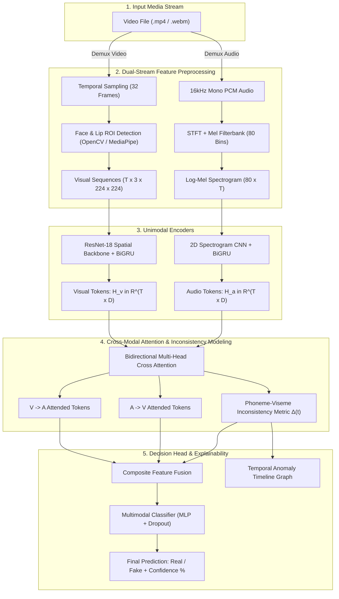

# Multimodal Deepfake Detection: Audio-Visual Cross-Modal Inconsistency Modeling

[](https://www.python.org/)
[](https://pytorch.org/)
[](https://developer.nvidia.com/cuda-toolkit)
[](LICENSE)

> **Final Year Major Project**  
> An AI forensic system that simultaneously analyzes video and audio streams to detect deepfakes, identifying semantic and temporal desynchronization between speech phonemes and lip visemes.

---

## 📌 Executive Summary & Motivation

Traditional deepfake detectors focus on **unimodal signals**—either visual artifacts (blending boundaries, eye blink irregularities, frequency warping) or acoustic anomalies (phase discontinuities, robotic spectral roll-off). However, recent generative advancements such as:
1. **Voice Cloning (SV2TTS / ElevenLabs / VALL-E):** Produces hyper-realistic speech without visual artifacts.
2. **Lip-Sync Reenactment (Wav2Lip / SadTalker / HeyGen):** Retains authentic voice while warping mouth movements to match an arbitrary script.
3. **Face Swapping (DeepFaceLab / SimSwap):** Modifies the face identity while leaving audio untouched.

In these advanced attacks, **unimodal detectors fail** because the isolated modality appears genuine.

Our project introduces a **Multimodal Audio-Visual Forensic Architecture** that simultaneously evaluates:
* **Visual Spatial & Temporal Features:** Face structure, blinking, and lip dynamics.
* **Acoustic Spectral Features:** Log-Mel Spectrograms, formant contours, and voice consistency.
* **Cross-Modal Synchronization:** Explicit bidirectional cross-attention modeling to detect **Phoneme-Viseme Inconsistency**.

---

## 🏛️ System Architecture



---

## 🔬 Mathematical Formulation

### 1. Acoustic Log-Mel Spectrogram Extraction
Given a discrete audio signal $x[n]$ sampled at $f_s = 16\text{ kHz}$, the Short-Time Fourier Transform (STFT) with window $w[m]$ and hop size $R$ is:
$$X(m, \omega) = \sum_{n=-\infty}^{\infty} x[n] w[n - mR] e^{-j\omega n}$$

The power spectrum $|X(m, \omega)|^2$ is mapped onto $M = 80$ triangular Mel filterbanks $H_m(\omega)$:
$$S(m, k) = \ln \left( \sum_{\omega} |X(m, \omega)|^2 H_k(\omega) + \epsilon \right)$$

### 2. Bidirectional Cross-Modal Multi-Head Attention
To determine whether facial articulation aligns with spoken phonemes, we compute bidirectional multi-head attention between visual tokens $\mathbf{H}_v \in \mathbb{R}^{T \times d}$ and audio tokens $\mathbf{H}_a \in \mathbb{R}^{T \times d}$:

$$\mathbf{Q}_v = \mathbf{H}_v \mathbf{W}_Q^v, \quad \mathbf{K}_a = \mathbf{H}_a \mathbf{W}_K^a, \quad \mathbf{V}_a = \mathbf{H}_a \mathbf{W}_V^a$$

$$\text{Attn}_{v \to a} = \text{softmax}\left( \frac{\mathbf{Q}_v \mathbf{K}_a^T}{\sqrt{d_k}} \right) \mathbf{V}_a$$

$$\text{Attn}_{a \to v} = \text{softmax}\left( \frac{\mathbf{Q}_a \mathbf{K}_v^T}{\sqrt{d_k}} \right) \mathbf{V}_v$$

### 3. Phoneme-Viseme Inconsistency Metric
At each temporal step $t$, the cross-modal discrepancy is measured via normalized cosine divergence:
$$\Delta(t) = \frac{1 - \cos(\mathbf{h}_{v \to a}(t), \mathbf{h}_{a \to v}(t))}{2} \in [0.0, 1.0]$$
* **Authentic Media:** Audio and lip visemes match, yielding $\Delta(t) \to 0$.
* **Deepfake (Wav2Lip / Audio Dubbing):** Mismatch triggers significant divergence spikes $\Delta(t) \to 1$.

### 4. Joint Multi-Task Objective Function
The network is optimized using a weighted multi-task loss regularizing unimodal branches alongside synchronization:
$$\mathcal{L}_{total} = \mathcal{L}_{BCE}(\hat{y}_{fused}, y) + \lambda_v \mathcal{L}_{BCE}(\hat{y}_v, y) + \lambda_a \mathcal{L}_{BCE}(\hat{y}_a, y) + \lambda_{sync} \|\bar{\Delta} - 0.8 \cdot y\|_2^2$$

---

## ⚖️ 3-Way Comparative Ablation Framework

A core objective of this project is answering: **Does combining modalities statistically outperform single-modality baselines?**

| Model Variant | Input Stream | Key Architecture | Primary Defect Detected |
| :--- | :--- | :--- | :--- |
| **1. Visual-Only** | Face & Lip Sequences | ResNet-18 + BiGRU | Face boundary warping, pixel blending, blinking anomalies |
| **2. Audio-Only** | 80-bin Log-Mel Spec | 2D-CNN + BiGRU | Synthetic vocal artifacts, phase glitch, high-frequency cutoff |
| **3. Late Fusion** | Video + Audio | Dense Concatenation | Isolated multi-modal confidence averaging |
| **4. Proposed Multimodal** | Synchronized Video + Audio | **Cross-Attention + Inconsistency Head** | **Semantic desynchronization between speech and lip shape** |

---

## 📁 Repository Structure

```text
Major Project/
├── config/
│   └── config.yaml               # Hyperparameters, paths, and model dimensions
├── data/
│   ├── raw/                      # Downloaded benchmark datasets (FakeAVCeleb)
│   ├── processed/cache/          # Fast-loading preprocessed tensor cache
│   └── sample_data/              # Synthetic test benchmark pairs
├── src/
│   ├── preprocessing/
│   │   ├── video_processor.py    # Face tracking, lip cropping, frame sampling
│   │   ├── audio_processor.py    # Demuxing, 16kHz resampling, Mel-Spectrogram
│   │   └── sync_aligner.py       # Cross-modal temporal window alignment
│   ├── models/
│   │   ├── visual_detector.py    # Visual unimodal detector (ResNet + BiGRU)
│   │   ├── audio_detector.py     # Audio unimodal detector (2D-CNN + BiGRU)
│   │   ├── cross_attention.py    # Multi-head cross-modal attention block
│   │   └── multimodal_fusion.py  # Unified multimodal architecture & ablation modes
│   ├── training/
│   │   ├── dataset.py            # PyTorch Dataset with SpecAugment & flips
│   │   ├── losses.py             # Multi-task loss with sync regularization
│   │   └── trainer.py            # GPU/AMP training engine with early stopping
│   ├── evaluation/
│   │   ├── metrics.py            # AUC-ROC, EER, F1, and ROC plotting
│   │   └── comparator.py         # Automated 4-way comparative ablation runner
│   └── inference/
│       └── pipeline.py           # End-to-end diagnostic and report generator
├── app/
│   └── app.py                    # Interactive Streamlit Web Forensic Dashboard
├── scripts/
│   ├── generate_sample_data.py   # Synthesize test dataset for immediate verification
│   ├── train.py                  # CLI training script
│   ├── evaluate.py               # CLI ablation study evaluator
│   └── run_inference.py          # Single-video diagnostic script
├── requirements.txt
└── README.md
```

---

## 🚀 Quickstart & Usage

### 1. Setup Environment
```bash
# Clone the repository and navigate into it
cd "Major Project"

# Install dependencies (with CUDA acceleration)
pip install torch torchvision torchaudio --index-url https://download.pytorch.org/whl/cu126
pip install -r requirements.txt
```

### 2. Generate Benchmark Dataset
Create the synthetic multi-class validation suite (covering real, faceswap, voiceclone, and lipsync desync):
```bash
python scripts/generate_sample_data.py
```

### 3. Run Comparative Ablation Study
Benchmark all 4 architectures side-by-side on the test dataset and generate paper-ready plots:
```bash
python scripts/evaluate.py --device cuda
```
*Outputs generated:*
* `reports/ablation_benchmark_results.md`
* `reports/roc_comparison_curve.png`

### 4. Train the Multimodal Model
```bash
python scripts/train.py --mode multimodal --epochs 10 --batch-size 4 --device cuda
```

### 5. Launch the Forensic Web Dashboard
```bash
streamlit run app/app.py
```
Open your browser at `http://localhost:8501` to:
* Test live video uploads.
* View spectrograms and face crops side-by-side.
* Inspect real-time **Phoneme-Viseme Inconsistency timelines**.
* Export forensic diagnosis certificates.

---

## 📊 Benchmark Evaluation Metrics

1. **AUC-ROC (Area Under Receiver Operating Characteristic):** Measures threshold-independent discriminability between real and fake samples.
2. **Equal Error Rate (EER):** The operating point where the False Acceptance Rate ($\text{FAR}$) equals False Rejection Rate ($\text{FRR}$). Lower is better.
3. **Inference Latency:** Evaluated in milliseconds per media second to guarantee near real-time operational deployment.

---

## 👥 Authors & Academic Context
* **Project Type:** Final Year Major Project (B.Tech / B.E. / M.Tech Computer Science / AI & ML)
* **Advisors & Department:** Department of Computer Science & Engineering
